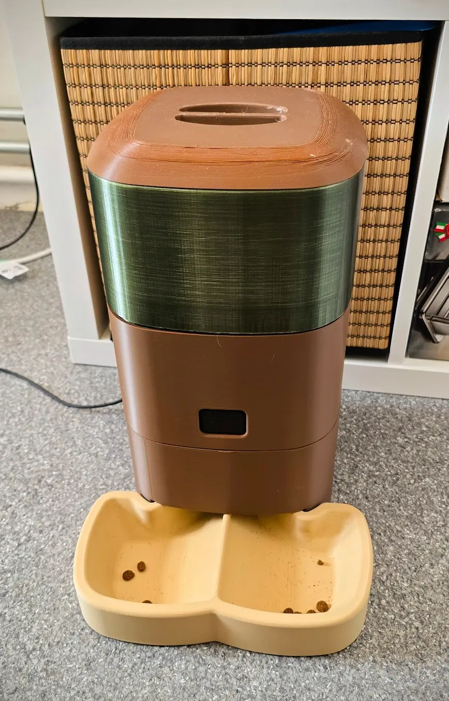

# Distributeur de croquettes connecté

*[English version](README.md)*

Un distributeur de croquettes piloté par un ESP8266 sous [ESPHome](https://esphome.io/) et commandé depuis
Home Assistant. Construit en novembre 2025.

La partie mécanique (réservoir, boîtier, gamelle) est un modèle publié sur MakerWorld, que j'ai imprimé. Le
firmware, l'électronique et l'intégration à Home Assistant sont de moi : c'est ce que contient ce dépôt.



## Ce qu'il fait

- **Deux repas programmés par jour.** Les heures sont réglées dans Home Assistant (aides `input_datetime`)
  et envoyées à la carte, qui garde les dernières valeurs en mémoire flash. Si Home Assistant est arrêté,
  le distributeur continue avec sa propre horloge (SNTP).
- **Portion réglable.** La portion correspond au temps de rotation du moteur, réglé par un curseur de 0 à 240 s.
- **Distribution manuelle** par un bouton dans Home Assistant, ou par le bouton physique du boîtier.
- **Mode automatique** à couper pour suspendre le programme (vacances, régime du vétérinaire), réactivé à chaque démarrage.
- **Capteur « dernière distribution »**, pour voir dans l'appli si l'animal a mangé.
- Mises à jour par Wi-Fi (OTA), page web locale protégée par mot de passe, point d'accès de secours si le Wi-Fi tombe.

## Matériel

| Pièce | Rôle |
|---|---|
| Wemos D1 mini (ESP8266) | fait tourner le firmware ESPHome |
| MOSFET sur `D1` | commande le moteur à courant continu du distributeur |
| Bouton poussoir sur `D2` (pull-up interne, anti-rebond 50 ms) | distribution manuelle |
| Boîtier, réservoir et double gamelle imprimés en 3D | d'après un modèle MakerWorld |

## Mise en route

1. Copier `secrets.yaml.example` en `secrets.yaml` et y mettre son Wi-Fi et ses clés
   (`secrets.yaml` est ignoré par git).
2. Flasher une première fois en USB, puis par le Wi-Fi :

   ```bash
   esphome run distributeur.yaml
   ```

3. Dans Home Assistant, ajouter l'appareil (intégration ESPHome, avec la clé de chiffrement de l'API) et
   créer deux aides `input_datetime` en heure seule : `heure_repas_matin` et `heure_repas_soir`.

## Comment le programme se déclenche

Chaque minute, l'horloge SNTP lance une lambda qui compare l'heure courante aux deux heures de repas
enregistrées. Si elles correspondent et que le mode automatique est actif, elle lance le script
`dispense_food` : moteur allumé, attente, moteur coupé, horodatage. Le script tourne en `mode: single` :
un appui sur le bouton pendant un repas ne peut pas en lancer un second.
